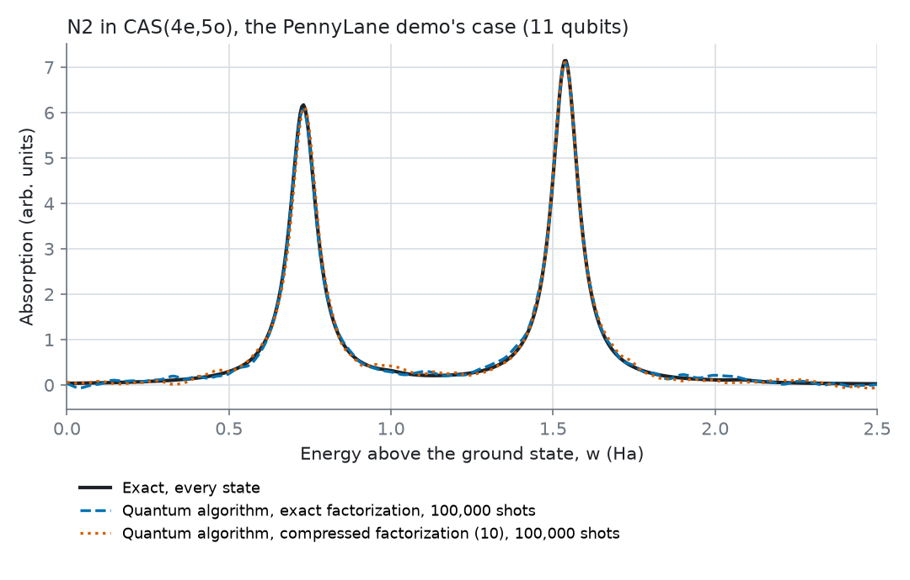
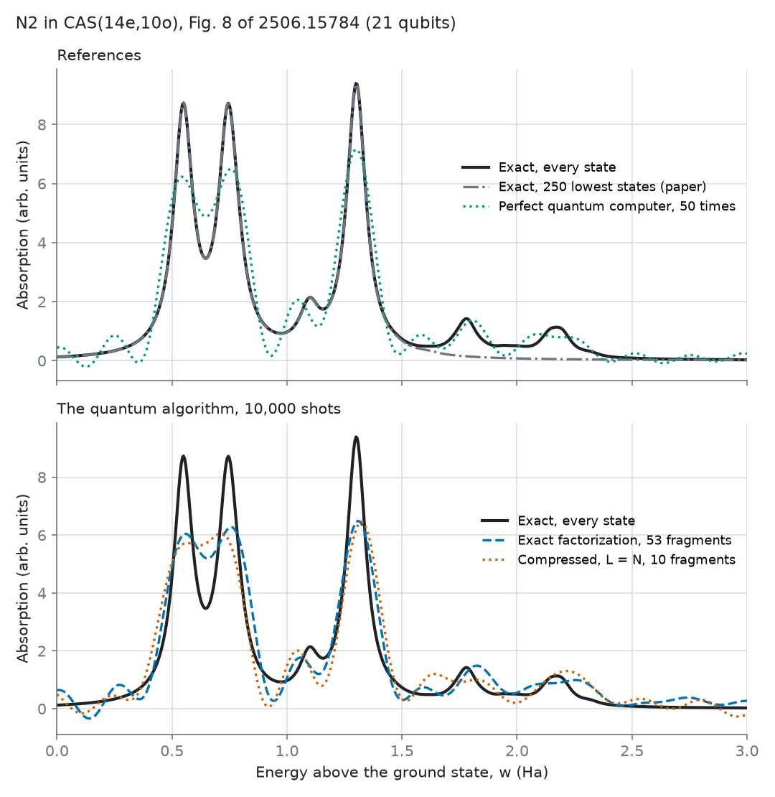
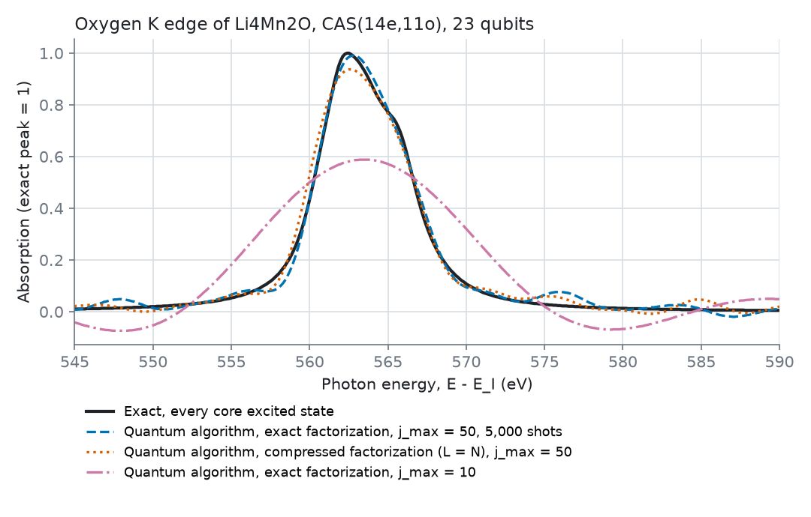
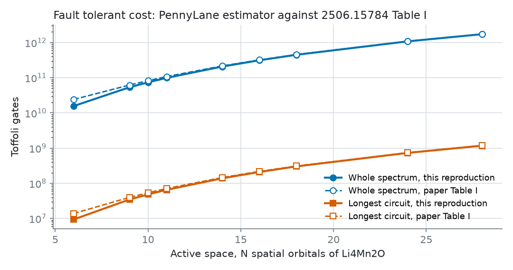

# Quantum XAS, step 1: the papers reproduced

Phase 1 of [PLAN-quantum.md](PLAN-quantum.md). Before building anything on the time domain XAS algorithm of Fomichev et al., we rebuilt it and checked it against exact classical answers and against the papers' own numbers. Everything here reruns from `scripts/quantum` in the pinned environment of `scripts/quantum/requirements.txt` (PennyLane 0.45.1, PennyLane Lightning 0.45.0, PySCF 2.14.0, Python 3.12; on Windows under WSL, since PySCF has no Windows wheels).

| Check | Script | Result |
| --- | --- | --- |
| The PennyLane demo, N₂ in CAS(4e,5o), 11 qubits | `repro_n2.py demo` | Peaks at 0.73 and 1.54 Ha, on the exact ones |
| Fig. 8 of 2506.15784, N₂ in CAS(14e,10o), 21 qubits | `repro_n2.py fig8` | Every peak found; the paper's own reference misses two |
| Table I of 2506.15784, fault tolerant cost for Li₄Mn₂O | `repro_resources.py` | Qubits exact, Toffolis within 5 percent from 14 orbitals up |
| Fig. 9 of 2506.15784, the Li₄Mn₂O oxygen K edge, 23 qubits | `repro_limno.py` | Converges to the exact edge; main peak within 0.4 eV |

`python -B -m unittest discover -s scripts/quantum -p "test_*.py"` runs the engine's checks (9 tests, under a minute); the deploy workflow runs them on every push.

## How the engine works

* `qxas/problem.py` builds a problem with PySCF: active space integrals, dipoles with the origin at the nuclear charge centre, the initial state, and the dipole excited states m|I⟩. With core valence separation (CVS) the core orbital stays active, every integral with an odd number of core indices is dropped (those are the terms that couple core excited and valence excited states), and the dipole keeps only core to valence terms. Dropping by index parity keeps the integrals' eightfold symmetry; PySCF stores integrals assuming it, so a rule that broke it would make PySCF and the emulator use different Hamiltonians, which an earlier draft did and a test now catches.
* `qxas/exact.py` gives two exact references: the lowest eigenstates (as the papers did) and a Lanczos spectral measure that holds every state the dipole reaches, however high.
* `qxas/cdf.py` factorizes the Hamiltonian into fragments, either compressed (CDF, the papers' choice) or exactly. The exact one keeps negative eigenvalues of the integral supermatrix too, which CVS integrals have.
* `qxas/circuit.py` is the demo's circuit in PennyLane gates: Hadamard test, basis rotations, double phase trick.
* `qxas/emulate.py` computes exactly what that circuit computes, without the 2²¹ amplitude register. With the double phase trick the two branches of the Hadamard test evolve under opposite rotations, so two vectors in the determinant basis (120 by 120 for N₂ in 10 orbitals) hold all the information. It agrees with the PennyLane circuit to 4×10⁻¹³ and runs about 450 times faster, which is what makes the 21 and 23 qubit checks practical on a laptop class CPU.
* `qxas/sampling.py` draws shots for the auxiliary qubit and rebuilds the spectrum with the paper's Eq. 11.

## The demo case

N₂ at 1.0 Å in STO-3G, CAS(4e,5o), η = 0.05 Ha, τ = 0.5 Ha⁻¹, 200 times, 100,000 shots, the demo's own settings. With an exact factorization the peaks fall exactly on the exact ones (0.73 and 1.54 Ha); the Trotter error moves the curve by 0.65 percent of the peak height and the shot noise by 1.6 percent. With the compressed factorization (10 fragments) the peaks move by at most 0.005 Ha (0.14 eV) and the curve by 4 percent.

## Fig. 8, N₂ in the full space

N₂ at 1.077 Å in STO-3G, all 10 orbitals and 14 electrons (20 + 1 qubits), j_max = 50, 10,000 shots, ‖H‖_ω = 3 Ha, τ = Δ = π/6 Ha⁻¹ and a randomized second order Trotter formula, as in the paper. The paper does not give η or α for this figure; we use its Table I values, η = 0.05 Ha and α = 1.3384. The run takes 18 minutes, most of it the 250 lowest states.

* **The paper's reference is incomplete.** Its 250 lowest states reach only 1.65 Ha above the ground state. The exact spectrum has two more peaks, at 1.78 and 2.17 Ha, which that reference cannot show (13.6 percent of the peak height). This is the deviation the paper saw and put down to missing states, now confirmed. States folded in from above 2π/τ, such as the core excitations near 15 Ha, change the window by only 1.6 percent.
* **With an exact factorization, the evolution time is the largest error.** A perfect quantum computer stopped at the 50 times (t up to 26 Ha⁻¹, where the Lorentzian kernel has only fallen to 0.27) is already 27 percent of the peak height away from the exact spectrum, as ringing and lower peaks. The Trotter error adds 6.6 percent and the shots 5.1 percent; every peak is found.
* **The compressed factorization at L = N dominates once it is used.** PennyLane's factorization with the paper's L = N = 10 leaves an integral error of 0.012 Ha; the spectrum moves by 34 percent of the peak height and peaks by up to 0.035 Ha (about 1 eV). The paper used its own factorization with BLISS symmetry shifts, which this does not reproduce.

## Fig. 9, the oxygen K edge of Li₄Mn₂O

The cluster is the O2 site of Li₂MnO₃ (COD 1008373, the more common of its two oxygen sites) with its first shell, two Mn at 1.904 and 1.912 Å and four Li at 2.04 to 2.17 Å, in cc-pVDZ. The paper gives neither the site, the charge nor the spin. We use a neutral cluster with 2S = 0: for that choice AVAS on Mn 3d and O 1s gives the paper's CAS(14e,11o), which needs 23 qubits (at 2S = 4 it gives 10 electrons instead). ROHF converges only with PySCF's second order solver. Core valence separation on the O 1s, ‖H‖_ω = 2 Ha so τ = Δ = π/4 Ha⁻¹, a second order Trotter formula, 5,000 shots and j_max from 5 to 50, as in the paper's Fig. 9. The paper had no classical reference at this size; ours is a Lanczos measure over all 108,900 determinants. The run takes 18 minutes.

* **The algorithm converges to the exact edge.** The difference from the exact spectrum falls from 65 percent of the peak height at j_max = 5 to 42, 11 and 5.7 percent at 10, 25 and 50 with an exact factorization, and to 9.7 percent at 50 with the compressed one (L = N = 11).
* **The main peak lands within 0.4 eV.** It sits at 562.4 eV in the exact spectrum, at 562.8 eV from the algorithm with an exact factorization and at 562.5 eV with the compressed one, with the shoulder near 566 eV in all three.
* **The absolute energy is about 30 eV too high** against the measured oxygen K edge of Li₂MnO₃ near 530 eV. That is expected from ground state orbitals with no relaxation around the core hole and a small basis, and it says nothing about the quantum algorithm, which reproduces this model's spectrum. Orbitals relaxed around the core hole, and alignment to measured spectra, come in later steps.

## Table I, the fault tolerant cost

PennyLane's estimator with the demo's circuit model and the paper's settings (η = 0.05 Ha, ‖H‖_ω = 2 Ha, j_max = 100, Trotter step √(η/1 Ha), α = 1.3384, S = 2500, rotations to 10⁻³, 10⁴ Slater determinants) and the paper's Eqs. 31, 32 and 40:

| Orbitals | Logical qubits (paper) | Toffolis, longest circuit (paper) | Toffolis, whole spectrum (paper) |
| --- | --- | --- | --- |
| 6 | 76 (76) | 9.4×10⁶ (1.39×10⁷) | 1.6×10¹⁰ (2.42×10¹⁰) |
| 10 | 84 (84) | 4.8×10⁷ (5.39×10⁷) | 7.4×10¹⁰ (8.26×10¹⁰) |
| 14 | 92 (92) | 1.39×10⁸ (1.46×10⁸) | 2.08×10¹¹ (2.17×10¹¹) |
| 18 | 100 (100) | 3.02×10⁸ (3.11×10⁸) | 4.49×10¹¹ (4.58×10¹¹) |
| 24 | 112 (112) | 7.32×10⁸ (7.45×10⁸) | 1.08×10¹² (1.09×10¹²) |
| 28 | 120 (120) | 1.17×10⁹ (1.19×10⁹) | 1.73×10¹² (1.74×10¹²) |

From 14 orbitals up every number is within 5 percent. Below that the gap grows (35 percent at 6 orbitals), where the cost of loading the initial state, which PennyLane and the paper model differently, is a large share of the total. All rows are in `src/data/quantum/repro/resources.json`.

## What we learned that the papers do not say

1. **The factorization, not the quantum algorithm, sets the accuracy.** With an exact factorization the emulated algorithm reproduces the exact spectrum to within its Trotter and shot errors. The compressed factorization adds an error of its own that shows directly in the peaks.
2. **PennyLane's compressed factorization can stall on symmetric orbitals.** It starts from zero rotations, where the gradient of every rotation that mixes orbitals of different symmetry vanishes. For N₂ with symmetry adapted orbitals it stopped at a 0.05 Ha error whatever the number of steps, factors or learning rate, which moved the peaks by 0.14 Ha (3.8 eV). A small seeded random start fixes it (about 0.003 Ha). The demo's own check, an error below 0.1 Ha, would not catch this.
3. **A classical reference built from the lowest states can miss what matters.** For Fig. 8 the paper's 250 states stop at 1.65 Ha. A Lanczos measure of the dipole excited state has every state it reaches and costs far less.
4. **Evolution time sets the accuracy before the Trotter error does.** With η = 0.05 Ha, stopping at t = 26 Ha⁻¹ leaves a quarter of the kernel and costs 27 percent of the peak height even on a perfect machine. A user tool must choose j_max from η, not the other way round.
5. **Results must be pinned to be reproducible.** Degenerate orbitals and orbital signs can come out differently on each run; point group symmetry and a sign rule (largest coefficient positive) make every problem, and its hash, the same each time.

## Limits of this step

* Everything quantum here is an exact classical emulation of the algorithm. No quantum hardware was used, and none of today's machines could run these circuits.
* The cluster models are the papers' kind: small, bare (no embedding) and with ground state orbitals. They test the algorithm, not the chemistry. Charge, spin and site for Li₄Mn₂O are our choices where the paper is silent.
* The resource numbers are the paper's model run through PennyLane's estimator; they inherit its assumptions (a 1 MHz logical clock, the active volume layout, 10⁴ Slater determinants).
